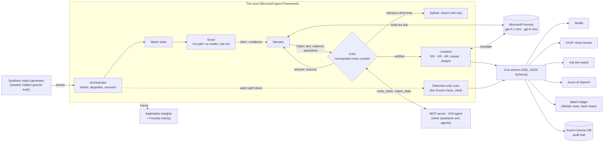

# HUDHUD

> Microsoft × Premier League — **Inside the Game: Developer Hackathon** (Oct 2026)
> AI match intelligence on synthetic football-realistic data. **Solo build.**

**Watch:**
- **The demo** (101 seconds): https://youtu.be/a9_2oL63PBw
- **The full walkthrough** (4 minutes): https://youtu.be/gQ50gp8kVg4

**Status:** live. **The studio** runs on Azure Container Apps (commentary written by gpt-4.1-mini on Microsoft Foundry, every number checked by the Critic before it airs) at https://studio.hudhud.com.pk/, private behind Cloudflare Access; the demo video shows it, and `make studio-offline` runs the same studio on any machine, no Azure needed. Showcase site: https://hudhud.com.pk/ . Media kit (both videos, screenshots and brand): https://drive.google.com/drive/folders/1gR1Umn8_yD58q-qaiEW2jR1co1S3AO9Y . Audit trail on Azure Cosmos DB, traces in Application Insights, 273 tests on every push (247 Python, 26 for the site and the studio).

**What it does:** the Scout flags goals, big chances, great passes, counterattacks, a high press paying off, swings in momentum, a match broken open end to end (control or chaos, also live on HUD²) and fouls with a card or a penalty in them (the ref's call, read from Law 12 at the competition's strictness); the Narrator writes the line; the Critic recomputes every number from the raw events and refuses what it can't prove; the Localizer airs it in English, Urdu or Arabic, on screen and spoken by Azure AI Speech. Viewers make it theirs (a club, a player, one number to follow), and at full time the match writes its own recap, every line checked by the Critic ([a sample](https://hudhud.com.pk/recap/seed-21.html)). Ask the match a question, live or after full time, in the studio or on its own page (`/ask`): who has the most of anything, a player, a side, a half, and follow-ups like "and Brackenfield?". The model calls the Scout's counting tools for every number it states, the Critic checks the answer before it shows, and each answer is sealed in the match ledger with a proof the browser checks (ADR 0010). With the voice on, a question can be asked out loud in English, Urdu or Arabic, and the answer is read back (`docs/ask-eval.md` measures the answers on unseen matches). The Critic also serves other agents over A2A, at `/a2a/` on the studio (ADR 0011), beside its MCP server. HUD², at `/hud` on the studio, shows the same match on one heads-up screen through the referee's, the commentator's or the fan's lens: every action drawn where it happened, every checked line pinned to the events it cites, and each viewer's own choice of layers (ADR 0012). Every match keeps a ledger: every event, line, refusal and answer, sealed minute by minute into blocks chained by hashes (Merkle roots as in Certificate Transparency, RFC 6962), so a changed byte shows; the studio verifies it in the browser, and `python -m court verify` offline (ADR 0013). It never predicts a result, never shows odds and won't help anyone bet: a question about bets or odds gets fixed words that steer away from gambling, before any model reads it (roadmap, principle 8). What it can't tell you is stated plainly on the site, and the generator's scorelines are checked against real results (`docs/realism.md`). The output stream has a JSON Schema (`apps/api/schema/`), the model calls show in Foundry's own tracing, and Foundry's evaluators judge the lines that aired (`docs/foundry-eval.md`).

## The pitch

Football broadcasts run on numbers, and more and more of the words around them will be written by
AI. A model that invents a statistic on air costs a broadcaster its credibility in one line.
**HUDHUD is AI match commentary that proves every claim before it airs.** Five agents work a live
synthetic match: the Scout detects what matters, the Narrator writes the line on Microsoft Foundry,
the Critic recomputes every number from the raw events and refuses what it can't prove, the
Localizer airs it in English, Urdu or Arabic, and the Orchestrator keeps the broadcast on air when a
model fails. Every line carries the events it stands on and a receipt (who wrote it, what it cost,
what was checked), and every match is sealed in a ledger chained by hashes. It is built on Microsoft
Agent Framework, Microsoft Foundry (gpt-4.1-mini, gpt-5-mini, Foundry's evaluators and tracing),
Azure Container Apps, Azure AI Speech, Azure Cosmos DB, Application Insights, an MCP server and an
A2A agent, with GitHub Copilot agent mode and the Azure MCP Server in the build.

## Architecture



The **hot path** sees every event and never waits on anything slow; the **warm path** runs each
alert through Narrator → Critic → Localizer as an Agent Framework workflow, with a rewrite edge
back to the Narrator. When the warm path fails, the Orchestrator announces it, airs the Scout's own
computed facts, still cited, and announces the recovery (ADR 0001). It all runs as one container on
Azure Container Apps, signed in to every Azure service with one managed identity and no keys
(`docs/azure.md`).

## The evidence law

- **Code counts, models write.** Every number a line may state is computed by code from the
  events; the model gets a fact sheet, never the raw arithmetic (ADR 0003).
- **No evidence, no air.** Each claim cites the events it stands on, and the Critic recomputes each
  number from those events and refuses any it can't prove, on screen with the reason.
- **Fail closed, never go dark.** A refused line is rewritten at most twice, then spiked; a failed model
  drops the broadcast to the Scout's facts, never to silence.
- **Say what it can't tell.** Synthetic clubs and players, no video, a measured momentum
  precision: the limits are stated on the site and in the studio.
- **Never a betting tool.** No predicted results, no odds; a betting question gets fixed words
  before any model reads it.

## Quickstart

```sh
make setup   # python3.13 venv + both workspace packages, editable
make test    # pytest: generator realism, Critic checks, workflow loop, warm-path failure
make eval    # the Scout's momentum calls scored against hidden ground truth (unseen seeds)

# live, on the models deployed in Foundry (Azure sign-in via scripts/az; see docs/azure.md)
.venv/bin/pip install -e "apps/api[foundry]"
scripts/live run --seed 21 --narrator foundry   # prints the cues and what the match cost
make demo    # one synthetic match, all five agents, in the console
make studio-offline  # the studio at http://localhost:8091, no Azure: a live match, the Critic's desk, the off-air switch
make studio  # the same, narrated by the Foundry models (Azure sign-in)
make site    # the showcase site at http://localhost:8000
scripts/live narrator-eval --seeds 5   # the models compete for the job (ADR 0005)
scripts/deploy-studio                  # ship the studio to Azure Container Apps
scripts/edge                           # the Cloudflare Worker in front of it (docs/azure.md, "The wall")
```

`python -m court run --help` lists the options (`--mode casual|analyst`, `--speed`, `--json` for the machine-readable cue stream, `--overreach` to make the offline narrator deliberately overreach so the Critic has something to reject).

## Layout

- `packages/event-schema/` (`match_events`): the stream contract (Pydantic + committed JSON Schema) and the deterministic synthetic match generator
- `apps/api/` (`court`): the agents. Orchestrator + Scout (hot path); Narrator → Critic → Localizer as an Agent Framework workflow (warm path)
- `site/`: the showcase site, one `index.html` in plain HTML/CSS/JS for GitHub Pages: a hash-routed single-page site (`#/problem`, `#/goal`, `#/how`, `#/recovery`, `#/data`, `#/explained`, `#/challenge`, `#/report`, `#/broadcast`, `#/why`, `#/roadmap`, `#/name`, `#/who`). Its claim and shot map are real output from synthetic match seed 7, generated by `scripts/site_sample.py` (`make site-data`) and drift-checked in CI; `tests/site/` checks the router, the crawler-facing tags and the assets. `#/explained` teaches the concepts (the evidence law, hash chaining, Merkle roots, the seal, the seed) as eight code-drawn animated scenes with tamper buttons (`assets/story.js`); `#/challenge` sets out the hackathon's brief, requirements, judging and rewards; `#/report` is the deliverables report (needed/delivered/how/next per ask), shipped as a PDF in the media kit by `scripts/drive_kit.py`; `#/broadcast` renders the cue contract as a program feed for broadcasters and streaming platforms (`demo/broadcast.html`)
- `docs/adr/`: architecture decisions (start with 0001, hot path / warm path)

## Files

- **super-prompt.md** — the Claude Code master brief: read-first order, locked architecture, hard constraints, session definitions of done
- **plan.md** — phased build plan (Oct 18 → 27) with definitions of done, cut order, and standing risks
- **task.md** — the official ask, decoded: rubric, prize categories, hard requirements, dates + the full Challenge brief
- **ideas.md** — solution options + the current fusion lean + decision gates
- **brand.md** — naming program, identity system, video compliance laws
- **project-names.md** — verified candidate register (all roots, live RDAP-checked 2026-10-16 and 2026-10-17); HUDHUD chosen
- **projects.md** — the reusable arsenal: existing projects → patterns → which idea they feed
- **awards.md** — the six prize lanes: official per-member packages, FMV, sweep math
- **goals.md** — the Grand Slam doctrine: all-six declaration, award→feature build contract, public-intention language, kill criteria
- **docs/submission.md** — the submission's text, ready to paste: pitch, links, testing instructions, the last checklist
- **roadmap.md** — Onwards & Upwards: the stages beyond the hackathon, from evidence-checked commentary to an AI fourth official that advises the referee

## Studying the tape

I did my homework. The greatest footballers and coaches study tape on the sides they're about to face, and while building this I studied the competition the same way. I read the other entries in the gallery for what each one promised, how it framed the problem and what it chose to show. It gave me inspiration as much as strategy: seeing the field side by side showed me which ideas were already well covered and where the open ground was. That study shaped this build's two headline features. One is a Critic that rejects unevidenced claims live, on screen; the other is an orchestrator that recovers from agent failure without dropping the broadcast.

My scouting notes stay off this repo out of respect for the other entrants. What I learned from them is in the code.

## Credits

Every match is synthetic, made by my own generator. The realism check compares its scorelines with Mart Jürisoo's *International football results from 1872* (public domain, CC0 1.0, https://github.com/martj42/international_results), used only as a benchmark and never committed. The ideas, tools and type I build on are
credited on the site's Credits page (`site/index.html`, `#/credits`): the Microsoft Reactor session
"Build AI-powered soccer insights apps with AKS and ACA" (Brian Benz, Oct 14, 2026), BETER's
*eFootball performance report* (September 2026; ideas for HUD² and the no-betting principle, cited
in roadmap.md), Microsoft
Foundry, Microsoft Agent Framework (MIT) with its A2A executor, the A2A Python SDK (Apache 2.0), Pydantic (MIT), Azure Identity, pytest and Ruff (MIT),
the fonts (SIL Open Font License), and Claude Code and GitHub Copilot agent mode.

## Build window

Oct 18–20 explore/architect · Oct 21–25 build · Oct 26 polish + 110s video · **Oct 27 submit** · winners Nov 20.

## Rules that bind

- Synthetic data only — no real PL match data
- Demo video < 2:00 hard cap · public URL
- Repo goes **public** at submission (private until showcase-ready)
- New code — patterns reused from existing projects, never the repos themselves
