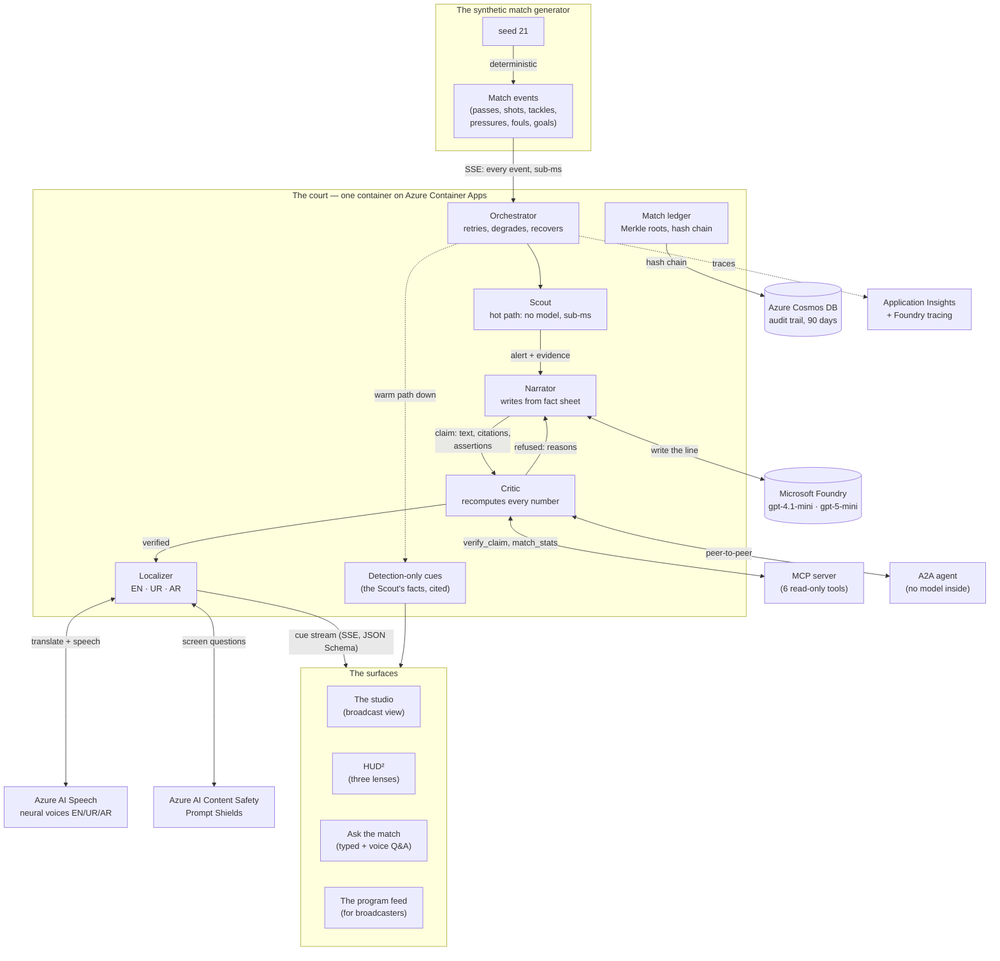
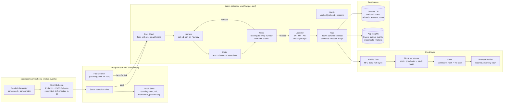
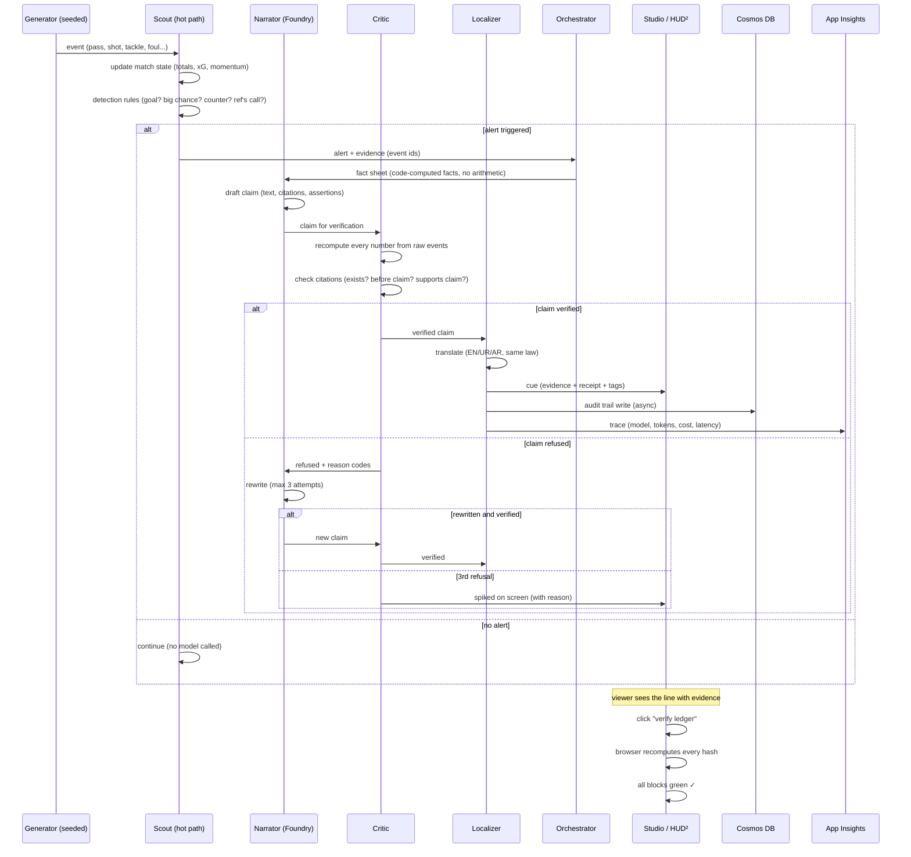

# Architecture

> The system at three levels: the bird's-eye view, the component detail, and the life of a claim.
> All diagrams are Mermaid — GitHub renders them inline. Start here, then read the ADRs (start with 0001).

## 1. High-level architecture: the system and its services

Five agents on Microsoft Agent Framework, one container on Azure, three data stores, four
surfaces. The hot path sees every event with no model; the warm path runs each alert through
Narrator → Critic → Localizer as a workflow.



**Key properties:**
- **Code counts, models write** — every number is computed by deterministic code from the events (ADR 0003)
- **No evidence, no air** — the Critic refuses what it can't prove, on screen with the reason
- **Fail closed, never go dark** — a failed model drops to cited facts, never to silence (ADR 0001)
- **One container, one identity** — managed identity to every Azure service, no keys (docs/azure.md)

## 2. Low-level architecture: the components and their contracts

The internal structure of each agent, the typed contracts between them, and the data that flows.
Every contract is a Pydantic model with a committed JSON Schema.



**The contracts (all typed, all committed):**

| Contract | Type | Fields | Where |
|---|---|---|---|
| Match event | Pydantic → JSON Schema | id, minute, type, team, players, x/y, type-specific | `packages/event-schema/` |
| Fact sheet | Pydantic | facts[] with id, label, value, event_ids | `apps/api/src/court/narrator.py` |
| Claim | Pydantic | text, citations[], assertions[] | `apps/api/src/court/critic.py` |
| Verdict | Pydantic | status, reasons[] (code + detail) | `apps/api/src/court/critic.py` |
| Cue | Pydantic → JSON Schema | id, kind, minute, headline, text, lang, mode, evidence[], status, attempts, priority, ttl_s, receipt, players[], call? | `apps/api/src/court/cue.py` |
| Ledger entry | SHA-256 canonical JSON | kind, id, text | `apps/api/src/court/ledger.py` |
| Block header | SHA-256 | height, minute, count, root, prev_hash, sealed_at | `apps/api/src/court/ledger.py` |

## 3. Data flow: the life of a claim

From the moment the generator emits an event to the moment a viewer sees a verified line and
can check its hash. This is the pipeline a claim travels, with every decision point.



## The ADRs (architecture decision records)

Thirteen decisions, each with context and consequences. Read in order for the full reasoning:

| # | Decision | Key choice |
|---|---|---|
| [0001](adr/0001-hot-path-warm-path.md) | Hot path / warm path | deterministic detection never waits on a model |
| [0002](adr/0002-baseline-relative-momentum.md) | Baseline-relative momentum | momentum vs a side's own recent baseline |
| [0003](adr/0003-models-write-code-counts.md) | Models write, code counts | every number computed by code, never by a model |
| [0004](adr/0004-audit-trail-cosmos-db-free-tier.md) | Audit trail on Cosmos DB | free tier, async writes, 90-day retention |
| [0005](adr/0005-evaluation-decides-the-narrator.md) | Evaluation decides | gpt-4.1-mini chosen by a committed evaluation rule |
| [0006](adr/0006-the-studio-live-on-container-apps.md) | Studio on Container Apps | one container, managed identity, no keys |
| [0007](adr/0007-the-critic-as-an-mcp-server.md) | Critic as MCP server | 6 read-only tools, any assistant can verify |
| [0008](adr/0008-pass-quality-speed-and-player-tags.md) | Pass quality, speed, tags | distance, accuracy, difficulty, badges |
| [0009](adr/0009-urdu-and-arabic-under-the-same-law.md) | Urdu and Arabic | same evidence law, no number added, no name changed |
| [0010](adr/0010-answers-stand-on-tool-facts.md) | Answers stand on tool facts | Ask the match: function calling + Critic check |
| [0011](adr/0011-the-critic-as-an-a2a-agent.md) | Critic as A2A agent | peer-to-peer, no model inside |
| [0012](adr/0012-hud2-one-match-three-lenses.md) | HUD² three lenses | referee, commentator, fan on one screen |
| [0013](adr/0013-the-match-ledger.md) | Match ledger | Merkle roots (RFC 6962), hash chain, browser verify |

## Picking up the codebase

```text
packages/event-schema/     The stream contract + the synthetic generator
apps/api/src/court/
  ├── server.py            FastAPI: the studio, HUD², Ask, the cue stream, MCP, A2A
  ├── scout.py             Hot path: detection rules, match state
  ├── narrator.py          Warm path: fact sheet → Foundry → claim
  ├── critic.py            Verification: recompute, refuse, verdict
  ├── localizer.py         Translation + speech, same law
  ├── orchestrator.py      Retry, degrade, recover
  ├── cue.py               The cue contract (Pydantic → JSON Schema)
  ├── ledger.py            Merkle tree, blocks, hash chain, seal
  ├── ask.py               Ask the match: tools + Critic + sealing
  ├── telemetry.py         App Insights exporter (Entra ID, no keys)
  └── studio/              The studio's HTML/CSS/JS (served by server.py)
site/                      The showcase site (GitHub Pages, plain HTML/CSS/JS)
scripts/                   Deploy, test, demo, the video director
infra/                     Bicep for Azure, the workbook JSON
```

**To extend the system:**
- **New detection** (a new kind of moment): add a rule in `scout.py`, a check in `critic.py`
- **New language**: add translations in `localizer.py`, a voice in `speech.py`
- **New claim type**: add the computation in `scout.py`, the check in `critic.py`, the template in `narrator.py`
- **New surface**: subscribe to the cue stream (SSE), or call the Critic's MCP tools
- **The ledger**: every new output kind gets sealed by adding to `ledger.py`'s entry types
